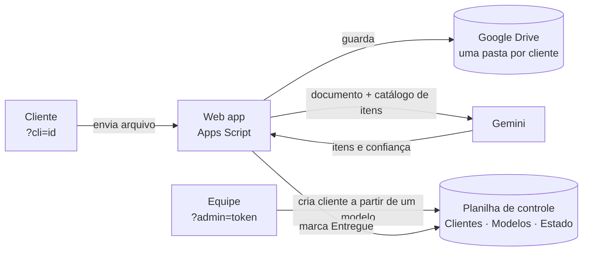

# Portal de Documentos (Apps Script)

[](https://github.com/FIlIpeDiBr/portal-documentos-apps-script/actions/workflows/ci.yml)

Web app em Google Apps Script para um escritório receber documentos de clientes. Cada cliente ganha um link com o seu checklist; ele arrasta os arquivos, o sistema guarda cada um no Google Drive e um modelo de linguagem (Gemini) identifica a qual item do checklist o documento corresponde e o marca como entregue.

Foi construído para um escritório de contabilidade. Está aqui sem dados de clientes e sem a identidade do escritório: nome, contato e listas de documentos são exemplos.

*[English version](README.en.md)*

## Como funciona



1. **Modelos de lista.** Um modelo diz quais documentos se espera. Há dois embutidos (onboarding e rotina mensal) e a equipe cria outros colando um texto, um documento por linha.
2. **Cliente.** Ao criar um cliente, os itens do modelo são copiados para a aba `Estado`. A cópia torna a lista do cliente imutável: editar ou excluir o modelo depois não muda o que já foi pedido a ninguém.
3. **Envio.** O arquivo é guardado na pasta do cliente antes de qualquer outra coisa. Só então vai para a IA, junto com o catálogo de itens daquele cliente.
4. **Classificação.** A resposta só marca itens que existem no checklist do próprio cliente e com confiança de 0,6 ou mais. Se a IA falhar ou não reconhecer o documento, ele fica guardado e a equipe confere à mão.

## Decisões de engenharia

**A lista de funções públicas é tratada como API.** No Apps Script, toda função global sem `_` no fim pode ser chamada pelo navegador de qualquer visitante do web app, inclusive de quem só tem um link de cliente. Aqui são nove, e um teste falha se a lista mudar. As cinco da equipe exigem o token como primeiro argumento. As duas de configuração (`inicializar`, `diagnostico`) precisam ser públicas para aparecer no editor, então não devolvem nada: o token e os links das pastas vão só para o log de execução.

**O link do cliente é a credencial, e só dá acesso ao checklist dele.** O id tem 122 bits aleatórios. Nenhuma função lista outros clientes sem o token, e a página do cliente não recebe o id da pasta no Drive.

**O documento é dado, não instrução.** O prompt diz ao modelo para ignorar ordens escritas dentro do documento ou do nome do arquivo. A garantia de verdade está no código: a resposta é filtrada pelos ids do catálogo enviado, então um PDF que mande "marcar tudo" não alcança nada fora do checklist de quem o enviou.

**Nada do que vem de fora é impresso sem escape.** Os dados da página entram em um `<script>` como JSON com `<`, `>`, `&` e os separadores de linha escapados, porque `JSON.stringify` sozinho deixa passar um `</script>` no nome de um cliente ou de um arquivo. Links de arquivo só viram `href` se forem `https`.

**Gravações com lock.** Criar e excluir cliente, criar e excluir modelo e marcar item como entregue passam pelo `LockService`. Sem isso, dois uploads simultâneos leriam a mesma linha e um apagaria o anexo do outro.

**A falha da IA não vira falha do envio.** O cliente recebe "recebido, a equipe confere"; o detalhe do erro (status HTTP, corpo da resposta) fica no log, não vai para o navegador.

## Estrutura

| Arquivo | O que tem |
|---|---|
| `src/config.gs` | Marca, limites, nomes de propriedades e de colunas |
| `src/modelos.gs` | Modelos embutidos e personalizados |
| `src/admin.gs` | Painel da equipe: clientes, modelos, URL do app |
| `src/cliente.gs` | Leitura do checklist e recebimento de arquivos |
| `src/classificacao.gs` | Prompt, chamada ao Gemini e validação da resposta |
| `src/webapp.gs` | `doGet`: escolhe a tela pela URL |
| `src/setup.gs` | Configuração inicial e diagnóstico |
| `src/util.gs` | Lock, ids, links, saneamento de nomes, JSON para `<script>` |
| `src/Index.html` | As três telas (restrita, cliente, equipe) |

## Publicando

Pré-requisitos: uma conta Google e o [clasp](https://github.com/google/clasp).

```bash
cp .clasp.json.example .clasp.json   # preencha o scriptId do seu projeto
clasp push
```

No editor do Apps Script:

1. Rode `inicializar`. Ela cria a pasta-mãe no Drive e a planilha de controle, gera o token de admin e escreve tudo no log de execução.
2. Em Configurações do projeto, crie a propriedade `GEMINI_API_KEY` com a sua chave. `GEMINI_MODELO` é opcional.
3. Implante como app da Web (executar como você, acesso para qualquer pessoa).
4. Abra `URL?admin=<token>`, cole a URL `/exec` na configuração e crie o primeiro cliente.

Para trocar nome, descrição e contato do escritório, edite `MARCA` em `src/config.gs`.

## Testes

```bash
npm test
```

São 37 testes com o `node:test`, sem dependência nenhuma. Os arquivos `.gs` são carregados em um contexto isolado com dublês em memória para planilha, Drive, propriedades, lock e HTTP. Cobrem a lista de funções públicas e o token em cada uma, o ciclo do cliente (criar, cópia imutável do modelo, excluir), o envio (limite, saneamento de nome e tipo, IA fora do ar, resposta fora do formato, tentativa de marcar item de outro cliente) e a página renderizada nos três modos, com um nome contendo `</script>`.

O CI roda a suíte no Node 20 e 22.

## Limitações conhecidas

- O token de admin vai na URL e fica no histórico do navegador. Um web app anônimo do Apps Script não tem sessão; a alternativa seria exigir login Google e conferir o e-mail.
- Quem tem o link do cliente envia arquivos e vê os nomes do que já foi enviado. Não há expiração nem revogação do link além de excluir o cliente.
- A planilha é o banco. Cada operação lê uma aba inteira, o que serve para dezenas de clientes, não para milhares.
- O arquivo viaja em base64 por `google.script.run`. O limite configurado é 25 MB.
- Os testes usam dublês dos serviços do Google. Nada roda contra o Apps Script de verdade, e do navegador só são testados o render e a compilação do script.
- A qualidade da classificação depende do modelo e não é medida por teste.

## Autor

Filipe Dias Brandão · [github.com/FIlIpeDiBr](https://github.com/FIlIpeDiBr)

Código publicado para fins de portfólio. Todos os direitos reservados.
